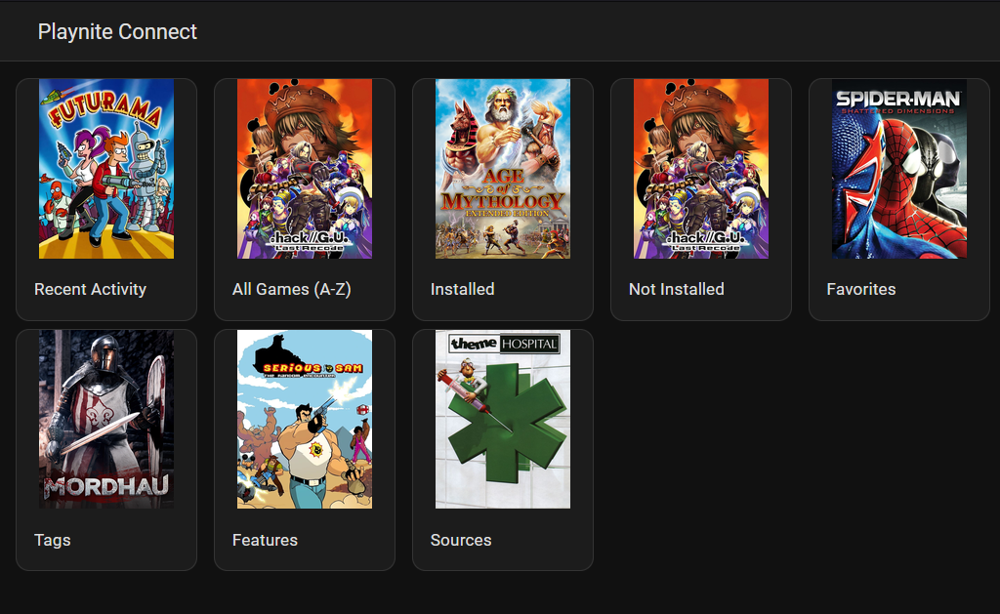
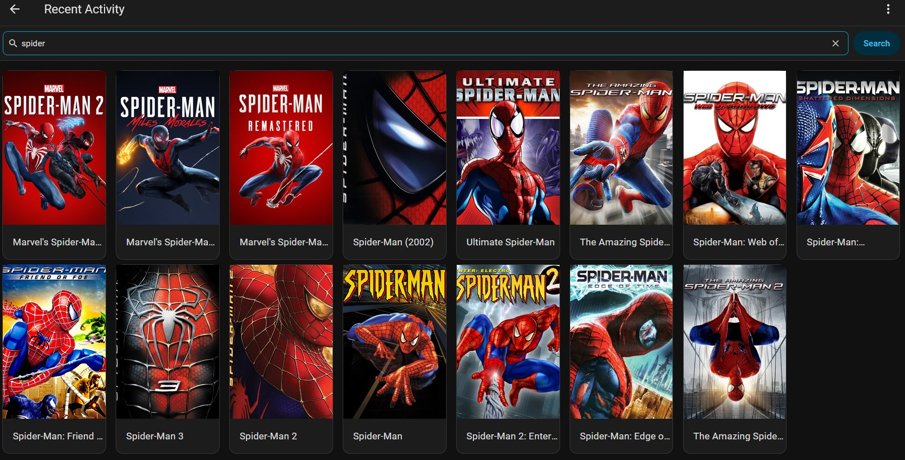

  

# Playnite Connect Companion

Playnite Connect Companion is the Home Assistant custom integration for the
[Playnite Connect](https://github.com/barrelltitor/playnite-connect) extension.
It connects a Playnite library to Home Assistant through MQTT.

## Features

- Browse and search the Playnite library through a single `media_player` entity.
- Launch, stop, install, uninstall, and restart games.
- Show the current game, selected game, active Playnite view, and game artwork.
- Expose a connectivity binary sensor so automations can wait for Playnite
  Connect to become reachable.
- Publish real Playnite game lifecycle events for Home Assistant automations.
- Make game search and launch available to automations, dashboards, and Home
  Assistant LLM tools.

## Screenshots

### Browse the library

### Search games

## Installation

First install the [Playnite Connect](https://github.com/barrelltitor/playnite-connect)
extension in Playnite and configure its MQTT broker settings. Note its Device
ID; the default is `playnite`.

### HACS (recommended)

1. Click the badge and choose **Add** when Home Assistant asks to add the
   repository as an **Integration**.
2. In HACS, find **Playnite Connect Companion** and select **Download**.
3. Restart Home Assistant.

### Manual installation

1. Copy `custom_components/playnite_connect` to
   `<config>/custom_components/playnite_connect`.
2. Restart Home Assistant.

### Finish setup

1. Go to **Settings → Devices & services → Add integration**.
2. Select **Playnite Connect Companion** and enter the Device ID configured in
   the Playnite extension.

On startup, the integration requests a library snapshot and uses a retained
snapshot immediately when one is available.

## Game artwork

Covers can be delivered in either of two ways:

- **MQTT** (default): no HTTP endpoint or token is needed. Covers are sent in
  small chunks only when Home Assistant requests them.
- **HTTP Cover API** (optional): enable **Cover API** and network access in the
  Playnite Connect extension settings, then enter its URL and token in the
  integration options.

Caching is optional. When enabled, covers are stored in
`<config>/playnite_connect_covers`; a large library can use significant disk
space.

## Availability

The **Available** connectivity binary sensor is `on` while the Playnite Connect
desktop extension is connected to MQTT and can accept commands. It is `off`
while it is unavailable, so an automation can start Playnite, wait for it to
come online, and then launch a game.

For example, [HASS.Agent](https://github.com/hass-agent/hass.agent) can expose
an action that starts Playnite. An automation can invoke
that action when **Available** is off, wait for the sensor to turn on, then use
`playnite_connect.search_and_play` or `playnite_connect.launch_game`.

## Events

The integration fires these Home Assistant events when Playnite reports a game
lifecycle change:

- `playnite_connect.game_installed`
- `playnite_connect.game_starting`
- `playnite_connect.game_started`
- `playnite_connect.game_stopped`
- `playnite_connect.game_uninstalled`

Each event includes the device ID, game ID, name, hidden/favorite and
installation/running state, install size, source, and classification data such
as platforms, categories, tags, features, and genres.

## Search and launch

The media player supports Home Assistant's standard
`media_player.search_media` and `media_player.play_media` actions. The
integration also provides these actions:

- `playnite_connect.search_games` — finds visible games by name and returns
  their exact Playnite game IDs.
- `playnite_connect.launch_game` — launches a game by exact `game_id`.
- `playnite_connect.search_and_play` — searches by name and launches a game
  only when exactly one game matches.

Use `search_and_play` in an automation when it must never choose between
similarly named games.

`search_games` also supports a blank title for filter-only searches and these
filters:

- `installation_state`: `both` (the default), `installed`, or `uninstalled`.
- `favorite_state` and `running_state`: both states by default, or either
  specific state.
- Exact, case-insensitive Playnite metadata filters: `source`, `platform`,
  `genre`, `category`, `tag`, and `feature`.
- `sort_by`: `relevance` (the default), `name`, or `recent_activity`.
- `limit`: 20 by default and up to 100 games.
- `offset`: 0 by default; use `next_offset` from a truncated response to fetch
  the next page.

Every search response includes `total_matches`, `returned_count`, and
`truncated`. Use those fields in an automation or AI workflow so a limited
result set is never mistaken for the full library. `uninstalled` means a game
is not currently marked installed by Playnite, so a game in an installation or
uninstallation transition can be included.

`search_and_play` accepts the same state and metadata filters, but deliberately
does not accept `limit` or sorting: it examines all matches and launches only
when exactly one remains.

## Data shown for each game

Each game includes its exact Playnite ID, name, hidden/favorite and
installation/running state, install size, last activity, source, platforms,
categories, tags, features, and genres. Hidden games are not shown in the Media
Browser.

## Stopping games

Playnite does not expose a generic stop-game method for extensions. To avoid
stopping an unrelated program, the extension only stops processes whose
executable path is inside the selected game's configured installation
directory. If it cannot identify such a process, the stop request fails rather
than risking an unrelated process.

## Honorable mentions

Playnite Connect Companion was initially forked from
[Playnite Web MQTT](https://github.com/cvele/playnite_web_mqtt).
